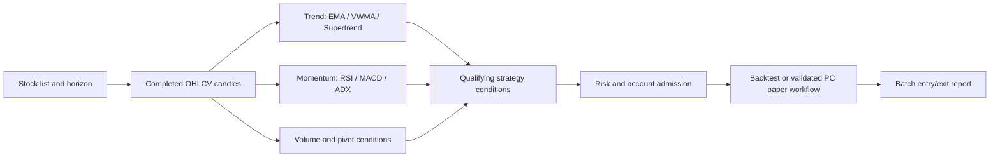

# Backtest errors, resolutions and operating URLs

Reviewed 9 November 2026 against batches f4681fd419194a7d9fd610eec726ae08
and 0fc87f3116974e93905e960dad87cdc6. This register separates implemented
changes from remaining engine work. It is not an approval for live trading.

| ID | Finding | Resolution | Status |
|---|---|---|---|
| E01 | Backtesting used a hidden default period. | Keep a Backtesting period selector; validate it against the horizon on the backend and persist/pass it to the history request and report. Intraday: 30/45/60 days; daily swing: 1/2/5 years; positional: 2/5 years. | Implemented in this change; deployment verification required. |
| E02 | Both “2y” reports actually simulate 103 daily bars, 15 June–9 November 2026. | Display requested period and actual common window separately. Remaining build: retain raw per-symbol coverage, identify limiting symbols, and implement explicit history eligibility/calendar rules before claiming the requested horizon was tested. Never invent missing candles. | Disclosure implemented; history-window redesign remains open. |
| E03 | VWMA backtest invests roughly 99.5–99.8% of available equity in each position; initial stop risk is about 3.5–6%. PC policy instead caps ordinary trade risk at 1% and capital per trade at 20%. | Make the backtest and paper engines consume one policy, then rerun account-level validation. Zero fixed reserve does not remove per-trade risk limits. | Open; no sizing changes or new risk approvals made here. |
| E04 | EMA20/50 has zero trades without rejection counters. | Distinguish insufficient indicators, absent qualifying signals, invalid risk brackets, capital rejections and position limits in backend diagnostics. Do not treat an empty valid report as proof of engine failure. | Open. |
| E05 | Reported drawdown is 13.34%, versus 10.67% from closed trades alone. | Export the marked equity curve and recompute peaks/drawdown from it. The trade export alone cannot verify open-position drawdown. | Open; no evidence yet that 13.34% is wrong. |
| E06 | Cloud and PC storage are confused because both are opened in Chrome. | Display runtime/storage source and the PC link on Reports. Render's disk recovery was independently verified on release ccbbec4f315f; PC storage remains separate. Cloud capacity errors now describe compute limits rather than calling durable storage temporary. | Storage labels/link corrected. Owner screenshot confirms cloud execution-role blockers (paper_trading_disabled, cloud execution disabled, paper_auto_entry_disabled); these are not disk errors. |
| E07 | Per-fill fees sum to ₹907.30; summary reports ₹907.29. | Disclose the ₹0.01 aggregate rounding difference. Keep calculations at full precision and round only display values. | Minor rounding difference; not evidence of corrupt storage. |
| E08 | Declared notebook conditions and implemented evaluators differ. | The chart labels conditions as registered rules, includes ambiguities and review-only status. EMA20/50's undefined reversal/low-volume exits and staged targets are not fully implemented. Align/version evaluator semantics before promotion. | Chart/disclosure implemented; evaluator parity remains open. |

## PC address and storage

On the same PC that runs the official launcher:

- Workspace: http://127.0.0.1:10000/app/
- Reports: http://127.0.0.1:10000/app/reports
- Paper: http://127.0.0.1:10000/app/paper_session

The official launcher defaults to port 10000 and binds to loopback. Use its
printed port if changed. Keep the existing DataRoot
`C:\Users\Lenovo\AppData\Local\TrendForgeCore`; do not create a second book to
remove a warning. The source files here do not establish that the PC service is
currently running. Cloud Codex has no connection to that PC.

The Render address uses Render's database. It cannot use a laptop database merely
because Chrome runs on that laptop. The report archive and PC paper ledger do
not automatically synchronize. The deliberate cloud read-only execution role
can block paper admission even when cloud report storage is durable.

## Conditions chart and public reference downloads

On Technical Scanner, expand **Scanner conditions, indicators and template
downloads**. Download the current registry chart and a ZIP containing six public
references, individual condition text files, source URLs and limitations.

Three Screener.in queries were read directly from their public Search Query
fields: Golden Crossover, Price Volume Action, and RSI Oversold. Two Streak
Open/Low and Open/High templates are adaptations of documented conditions;
the multi-timeframe example is a published reference with unverified indicator
periods. Native Streak scanner pages could not be retrieved. Do not label these
as native Streak exports or register them automatically as execution strategies.

The chart is a registry reference, not a validation result. SMA/DMA, EMA, RSI
conventions, higher-timeframe closure and point-in-time fundamentals must be
checked before integrating external templates. No templates submit orders.

Each strategy uses its declared subset of indicators; the diagram does not add
all indicators as mandatory conditions to every strategy.
